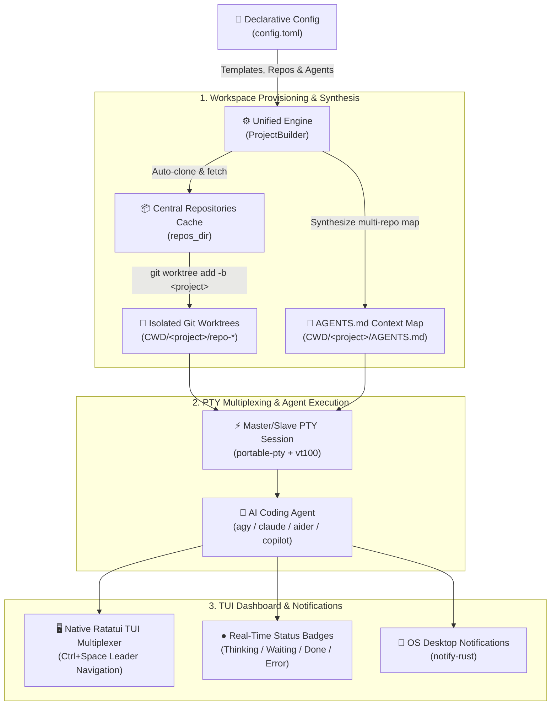

<p align="center">
  
</p>

<p align="center">
  <strong>Multi-Repo Workspace Orchestrator & Session Multiplexer for AI Workflows</strong>
</p>

<p align="center">
  <a href="https://www.rust-lang.org/"></a>
  <a href="LICENSE"></a>
  <a href="#platform-support"></a>
</p>

---

## Overview

**`botai`** is a cross-platform multi-repo workspace orchestrator and session multiplexer for AI agent workflows (**Google Antigravity / `agy`**, **Claude Code**, **GitHub Copilot CLI**, **Aider**, and custom tools) written in idiomatic Rust.

Modern AI coding agents excel at single-directory tasks but struggle when real-world engineering spans multiple microservices, frontend applications, shared libraries, and infrastructure repositories. `botai` eliminates this friction by automating isolated Git worktree provisioning, synthesizing multi-repo context orientation maps (`AGENTS.md`), and multiplexing agent sessions inside a native, dependency-free terminal user interface.

---

## Why `botai`?

| Challenge | Without `botai` | With `botai` |
| :--- | :--- | :--- |
| **Multi-Repo Workflows** | Manual cloning, switching branches across multiple repos, accidental dirty working tree clobbering. | **Declarative Templates & Git Worktrees**: One command provisions isolated worktrees across all template repos under `CWD/<project_name>`. |
| **Agent Context & Orientation** | Agents lack awareness of peer repositories, cross-project dependencies, and service contracts. | **Automated Context Synthesis**: Automatically generates `AGENTS.md` with directory trees, repo purposes, and custom template rules. |
| **Multiplexing Dependencies** | Requires installing, configuring, and maintaining external multiplexers (`tmux`, `zellij`). | **Zero-Dependency Rust PTY**: Built-in ConPTY / UNIX PTY multiplexer with `Ctrl+Space` leader navigation and mouse scroll passthrough. |
| **Agent Monitoring** | Constantly switching terminals to check if long-running agent tasks have finished or need input. | **Real-Time Visual Badges & OS Notifications**: Tab indicators (`● Thinking`, `● Waiting`, `● Done`, `● Error`) and native desktop alerts via `notify-rust`. |

---

## Key Features

- 🌳 **Multi-Repo Workspace Isolation**  
  Define project stacks in declarative TOML templates. `botai` automatically clones missing repositories to a central cache (`repos_dir`), fetches upstream branches, and provisions independent Git worktrees checked out to a clean feature branch inside `CWD/<project_name>`.
- 🧠 **Automated Context Synthesis (`AGENTS.md`)**  
  Every project environment is automatically seeded with an orientation document detailing the directory layout, repository roles, inter-service relationships, and optional custom instructions (`agents_md_append`).
- ⚡ **Embedded Rust PTY Multiplexer**  
  Built with `portable-pty`, `vt100`, and `ratatui`. Features dynamic viewport resizing (`SIGWINCH` / `ResizePseudoConsole`), accurate hardware cursor positioning, ANSI mouse scroll forwarding, and an intuitive `Ctrl+Space` leader key architecture.
- 🔔 **Real-Time Agent State Monitoring**  
  Live visual status dot indicators (`●`) track agent lifecycles in real time:
  - **Thinking / Busy**: Agent is generating code or running commands.
  - **Waiting for Input**: Agent requires user approval or prompt response.
  - **Done / Idle**: Agent finished its task cleanly.
  - **Error / Interrupted**: Process crashed or exited with a non-zero status code (output preserved for inspection).
  Native OS desktop notifications alert you immediately when tasks finish or need attention.
- 🎨 **Multiple Built-in Color Themes**  
  Ship with carefully crafted palettes: **Tokyo Night** (default), **Catppuccin Mocha**, **Cyberpunk**, **Gruvbox Dark**, **Monochrome / Slate**, and standard **ANSI 16-color**.
- 🚀 **Interactive TUI Dashboard & CLI Suite**  
  Launch `botai` without arguments for a full-screen interactive project switcher and creation wizard, or use fast, scriptable CLI commands (`botai start`, `botai sync`, `botai list`, `botai attach`, `botai destroy`).

---

## Architecture & Workflow



---

## Quick Start

### Installation

#### Option 1: Build & Install from Source (Cargo)
Ensure [Rust 1.74+](https://www.rust-lang.org/tools/install) is installed:

```bash
# Clone the repository
git clone https://github.com/okunnig/botai.git
cd botai

# Build and install binary to ~/.cargo/bin
cargo install --path .
```

#### Option 2: Release Packaging Script
Package standalone distribution archives (`.tar.gz` for Linux/macOS, `.zip` for Windows) with cryptographic SHA-256 manifests:

```bash
./scripts/build.sh
```
Compiled archives will be generated in `dist/` (e.g. `dist/botai-v0.1.0-linux-x86_64.tar.gz`).

---

### Initial Configuration

Generate a self-documenting starter configuration template:

```bash
# Create default configuration (~/.config/botai/config.toml or %APPDATA%\botai\config.toml)
botai init
```

To print the configuration template to stdout without writing to disk:
```bash
botai init --stdout
```

---

## Usage Guide

### 1. Interactive TUI Dashboard
Running `botai` without arguments opens the full-screen interactive project manager:

```bash
botai
```

From the dashboard you can:
- Browse all existing projects in your current directory with live running session status dots.
- Press `n` or `c` to open the **Interactive Project Creation Modal** (search templates, preview repositories, select agent CLI, and initialize).
- Press `Enter` to attach to any running or idle project session.
- Press `d` to cleanly destroy a project worktree and prune Git metadata.

---

### 2. Command-Line Interface (CLI)

```bash
# Start a new multi-repo project from a template and launch agent
botai start ecommerce feat-checkout --prompt "Implement payment webhook listener"

# Start with a specific AI agent tool override
botai start backend-services api-v2 --agent agy

# Sync and pre-clone all remote repositories defined in a template
botai sync ecommerce

# List all configured templates, cached repositories, and active projects
botai list

# Attach to an existing project session
botai attach feat-checkout

# Cleanly remove project worktrees and prune Git metadata
botai destroy feat-checkout

# Force removal of a project even if uncommitted changes exist
botai destroy feat-checkout --force
```

---

## Keybindings Reference

### Interactive Dashboard Shortcuts

| Keybinding | Action |
| :--- | :--- |
| `↑` / `↓` or `k` / `j` | Navigate project list |
| `Enter` | Attach / switch to selected project session |
| `n` or `c` | Open New Project Creation Modal |
| `d` | Open Destroy Project confirmation dialog |
| `q` or `Esc` | Quit `botai` |

---

### In-Session Multiplexer Leader Keys (`Ctrl + Space`)

When working inside an active terminal session, press `Ctrl + Space` to enter **Leader Mode** (indicated by `[LEADER]` in the status bar), then press any of the following keys:

| Leader Shortcut | Action |
| :--- | :--- |
| `Ctrl+Space` then `1` .. `9` | Directly switch to project session tab 1 through 9 |
| `Ctrl+Space` then `n` | Switch to the **Next** active session tab |
| `Ctrl+Space` then `p` | Switch to the **Previous** active session tab |
| `Ctrl+Space` then `c` (or `n`) | Open **In-Session Quick Launcher & Project Navigation Modal** |
| `Ctrl+Space` then `w` (or `x`) | Close / terminate active project session |
| `Ctrl+Space` then `d` | **Detach** from session (returns to dashboard or shell while keeping agents running) |
| `Ctrl+Space` then `q` | Quit `botai` |
| `Ctrl+Space` then `Ctrl+Space` | Send a literal `Ctrl+Space` (`0x00`) byte to the active PTY |
| `Ctrl+Space` then `Esc` | Cancel leader mode |

---

### Project Creation Modal Navigation

| Keybinding | Action |
| :--- | :--- |
| **Typing characters** | Real-time template filter search (Step 1) or text field input (Step 2) |
| `↑` / `↓` or `k` / `j` | Navigate filtered template list (Step 1) |
| `Tab` / `Shift+Tab` | Move focus between form fields (Project Name, Agent CLI, Prompt) |
| `←` / `→` | Cycle through available AI Agent tools (`claude`, `agy`, `copilot`, `aider`) |
| `Enter` | Confirm selection / advance to Step 2 / start asynchronous project builder |
| `Esc` or `Backspace` (empty) | Go back to Step 1 / dismiss modal |

---

## Configuration (`config.toml`)

Configuration is stored at:
- **Linux / macOS**: `~/.config/botai/config.toml` (or `$XDG_CONFIG_HOME/botai/config.toml`)
- **Windows**: `%APPDATA%\botai\config.toml`

### Example Configuration

```toml
# ==============================================================================
# botai - Multi-Repo Workspace Orchestrator Configuration File
# ==============================================================================

# Global default AI agent tool when a template does not specify an override
default_agent = "agy"

# Color theme: "tokyo-night", "catppuccin", "cyberpunk", "gruvbox", "monochrome", "ansi"
theme = "tokyo-night"

# Central directory where remote Git repositories are cloned and cached (required)
repos_dir = "~/.local/share/botai/repos"

# ------------------------------------------------------------------------------
# Agent Definitions
# ------------------------------------------------------------------------------
# Configure the AI agent CLI executable commands, default arguments, and environment variables.

[agents.agy]
command = "agy"
args = []

[agents.claude]
command = "claude"
args = []
# env = { ANTHROPIC_API_KEY = "sk-ant-..." }

[agents.copilot]
command = "gh"
args = ["copilot", "suggest"]

[agents.aider]
command = "aider"
args = ["--no-auto-commits"]

# ------------------------------------------------------------------------------
# Project Templates
# ------------------------------------------------------------------------------
# Define named multi-repo project templates.

[templates.ecommerce]
description = "E-commerce platform services (API, Web Frontend, Shared Models)"
default_agent = "agy"
agents_md_append = """
- Run integration tests with `cargo test --workspace`.
- Check OpenAPI schema parity before modifying endpoints.
- Adhere to the zero-unsafe Rust policy across all crates.
"""
repos = [
  "https://github.com/example/ecommerce-api.git",
  "https://github.com/example/ecommerce-web.git",
  "/home/user/code/ecommerce-shared"
]
env = { PORT = "8080", NODE_ENV = "development" }

[templates.microservices]
description = "Core backend microservices stack"
default_agent = "claude"
repos = [
  "git@github.com:org/auth-service.git",
  "git@github.com:org/billing-service.git",
  "git@github.com:org/notification-service.git"
]
```

---

## Supported Color Themes

| Theme Name | Description | Dominant Palette |
| :--- | :--- | :--- |
| **`tokyo-night`** *(Default)* | Deep slate/navy chrome with electric blue accents and warm amber leader indicator. | Slate `#1a1b26`, Blue `#7aa2f7`, Purple `#bb9af7`, Gold `#e0af68` |
| **`catppuccin`** | Soothing pastel aesthetic with mauve borders and peach accents. | Crust `#1e1e2e`, Mauve `#cba6f7`, Sky `#89dceb`, Peach `#fab387` |
| **`cyberpunk`** | High-contrast synthwave cyber aesthetic with hot magenta and electric cyan. | Black `#0a0a0f`, Magenta `#ff007f`, Cyan `#00f0ff`, Yellow `#ffe600` |
| **`gruvbox`** | Warm retro earthy palette with rust orange active tabs and forest green badges. | Dark `#282828`, Orange `#fe8019`, Green `#b8bb26`, Yellow `#fabd2f` |
| **`monochrome`** | Clean, minimalist zinc/slate dark tones with crisp white borders. | Dark Zinc `#18181b`, Slate `#27272a`, Ice Blue, Pure White `#f4f4f5` |
| **`ansi`** | Universal 16-color ANSI terminal fallback without 24-bit TrueColor requirements. | Standard terminal cyan, green, yellow, red, gray, white |

---

## Technical Specifications & Architecture

For in-depth technical requirements, Git worktree lifecycle management, ConPTY integration, and test matrices, refer to [REQS.md](REQS.md).

---

## License

Dual-licensed under either:
- **MIT License** ([LICENSE-MIT](LICENSE) or [http://opensource.org/licenses/MIT](http://opensource.org/licenses/MIT))
- **Apache License, Version 2.0** ([LICENSE-APACHE](LICENSE) or [http://www.apache.org/licenses/LICENSE-2.0](http://www.apache.org/licenses/LICENSE-2.0))

at your option.
